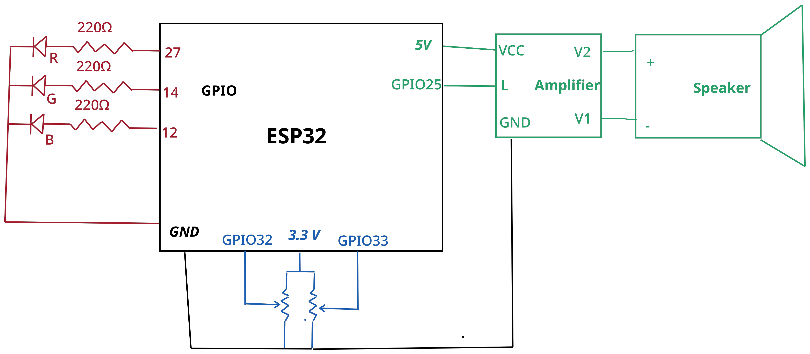
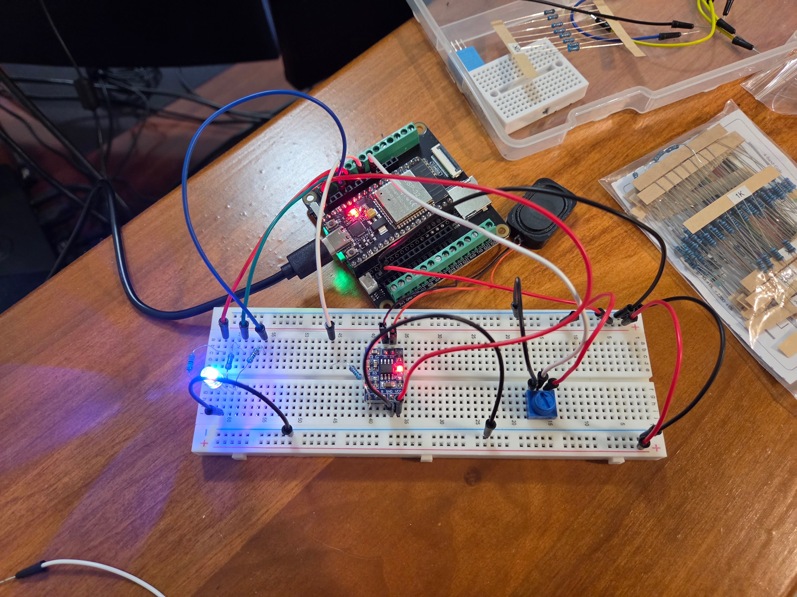



# Introduction

My project is a Bluetooth notification system connected to my laptop. This uses my ESP32 controller's Bluetooth connectivity to connect to my laptop, with my ESP32 connected to a RBG LED and speaker activated on a notification.
The color of the LED and sound the speaker makes varies based on the type of notification received: for example, the LED flashes red and the speaker makes a whining sound when my laptop sends a warning notification. 
On a success notification (like a file transfer finishing), the LED flashes green and the speaker plays a pleasant sound. Additionally, the LED brightness and speaker volume is modifiable with potentiometers ---  you can change the volume and brightness individually with a potentiometer for each.

As the ESP32 is connected over Bluetooth, it can activate the LED and buzzer even when not plugged in to the laptop; it works as long as it is powered and connected wirelessly over Bluetooth.

I chose this project because I saw an advertisement for the Google Pixel 11 and the main selling point --- and, as far as I can tell, the only difference from the Pixel 10 --- was that it has a notification LED on the back [@madebygoogleGooglePixel112026]. I thought that it was pretty pointless to release a new phone just to add that, so I'm doing this out of spite towards Google. If I can make a notification LED, then it's pretty pointless for them to make such a big deal of it. And, to a lesser extent, I think that the LED is pretty, so I thought that it might be a neat thing to have.

# Design

## Block Diagram

{#fig-block-diagram}

As shown in @fig-block-diagram, my project consists of my laptop, which runs a program that, after a laptop notification is received, sends the notification's type over Bluetooth to the ESP32. Based on the notification type, the ESP32 chooses a sound and LED color. Then, the ESP32 reads the voltage from the two potentiometers, one determining the brightness of the LED and the other the volume of the speaker. The higher the voltage from each of these potentiometers, the higher the brightness/volume will be. The ESP32 then plays a sound on the speakers and sets the color and brightness of the RGB LED.

## Circuit Diagram

{#fig-circuit-diagram}

### Potentiometers

The brightness of the LED and speaker volume is determined by the output voltage of the potentiometers, shown in blue. The analog level of `GPIO32` determines the brightness of the LED: a higher level incerases the brightness of all LEDs, and a lower level decreases the brightness of all LEDs.

The analog level of `GPIO33` determines the loudness of the speaker; the higher, the louder the speaker will be when a notification is received.

## RGB LED

In red is the RGP LED, which is represented as 3 separate LEDs. The brightness of each LED depends on the color for the notification and how the overall brightness of the LED.

## Speaker

In green is a speaker and audio amplifier module. The `L` pin on the amplifier transmits the mono audio signal; `V1` and `V2` are connected to the poles of the speaker @AudioModuleSpeakera. This matches the setup in the Sunfounder tutorial @73BluetoothAudio to make it easier to build.

## Software Plan

I will use a Python script that will listen for system notifications. When it receives one, it will determine what type it is, and send a Bluetooth signal to the ESP32 with the notification type.

Upon receiving the Bluetooth signal, the ESP32 will pick the sound and LED color, change those based on the potentiometer values, and output those to the LED and Audio Module for 5 seconds before turning them off.

### Pseudocode

```python
# python script
notification_type = await_notification()
send_bluetooth_signal('ESP32', notification_type)

# esp32 code
notification_type = await_bluetooth_signal()
brightness = read_brightness_potentiometer()
volume = read_volume_potentiometer()

color = choose_color(notification_type) * brightness
sound_signal = choose_sound(notification_type) * volume

set_led(color)
play_sound(sound_signal, volume)

delay(5s)

set_led('off')
play_sound('none')
```

## Preliminary Complexity

### Inputs

The ESP32 receives input over Bluetooth; when it receives a signal, it activates the LEDs and speaker. Another input is the potentiometer, whose output voltage determines the LED brightness and speaker volume.

### Outputs

The ESP32 will turn on RGB LED and speakers when a notification is received.

### New Components

New components are the speaker/amp and an RGB LED, which will make a sound and light up, respectively, when a notification is received.

### Complexity Score

| Item                 | Score     |
|----------------------|-----------|
| RGB LED              | 2         |
| Audio Module         | 4         |
| Bluetooth            | 5         |
| Potentiometers       | 1 + 1 = 2 |
| **Complexity Score** | **13**    |

## Final Design

## Build Process

### Arduino Setup

{#fig-init-circuit}

I started off by building the initial circuit @fig-init-circuit. This is where I tested that my LED setup worked, with initial code @lst-led-test-code.

I then moved to testing the Bluetooth, making sure that I could receive signals over a connection; I tested that I could control the LEDs with a Bluetooth signal while using a dummy value for the sound to play --- specifically, I had the ESP32 accept a 4 byte value, with the first 3 bytes signalling the color of the LED and the 4th byte signalling what sound to play. This followed content on the Sunfounder tutorial for controlling an RGB LED over Bluetooth @72BluetoothControl, though I didn't use the app specified in the tutorial, in favor of coding the Bluetooth client in my Python script.

I then wired my speaker module according to @73BluetoothAudio, though didn't follow the code provided. Instead, I used the audio API provided in header files like AudioGeneratorMP3.h AudioFileSourceLittleFS.h, AudioOutputI2SNoDAC.h so that I could play files that I uploaded to the ESP32 with LittleFS. The .mp3 audio files I used were gathered from @130000FreeSound. I tested if the speaker worked as intended, but only a loud pop at the start and end of an audio file was audible; this turned out to be due to using AudioOutputI2S, when I needed to use AudioOutputI2SNoDAC to properly handle the audio. After switching to this, the speaker worked as intended, but had a fair amount of static. As such, I added a high-pass filter with two capacitors from the kit before the input to the audio amplifier, which removed some static; I switched to a 1 k$\Omega$ resistor from 10 k$\Omega$ to compensate for the reduced volume after adding the filter.

### Python Setup

I used dbus-fast to connect to my computer's notification interface @BluetoothDevicesDbusfastFaster. This library allowed me to connect to the Linux DBus, which is what messages (including notifications) are sent over. In short, I used this to listen to notifications to my desktop, as well as job status updates --- which was for listening to the status of file transfers. I initially had Gemini generate a script called `ai_listen.py` as a reference for how to connect, but I ultimately made my own script without AI assistance and did not reference the AI script when making it.

The code is split over multiple files, so I uploaded it to a [GitHub repostiory](https://github.com/tzheng7679/ece_2360_project) at 

## Functionality

Link to video: [https://photos.app.goo.gl/kMp4dF2hSifwEMBp7](https://photos.app.goo.gl/kMp4dF2hSifwEMBp7).

This video demonstrates the project showing notifications with the LED and speaker, with the color and sound differing depending on the type of notification. It also shows changing the LED brightness based on the potentiometer setting, as well as it working for tracking file transfers (albeit with a delay between the file transfer finishing and activating the LED and speaker).

## Final Complexity 

Complexity is slightly different from [the initial score](#complexity-score): I removed 1 of the potentiometers (only keeping 1 for the LEDs, since I didn't have the time to do one for the speaker), and added 2 capacitors for the speaker's filter. Otherwise, the inputs, outputs, and new components remain the same as in [the preliminary design](#preliminary-complexity), minus the potentiometer for speaker volume:

### Inputs

The ESP32 receives input over Bluetooth; when it receives a signal, it activates the LEDs and speaker. Another input is the potentiometer, whose output voltage determines the LED brightness. This still meets the requirement for one input.

### Outputs

The ESP32 will turn on RGB LED and speakers when a notification is received. This still meets the requirement for one output.

### New Components

New components are the speaker/amp and an RGB LED, which will make a sound and light up, respectively, when a notification is received. This still uses new components.

### Final Complexity Score


| Item                 | Score     |
|----------------------|-----------|
| RGB LED              | 2         |
| Audio Module         | 4         |
| Bluetooth            | 5         |
| Potentiometers       | 1         |
| Capacitors           | 1 + 1 = 2 |
| **Complexity Score** | **14**    |

## Code Progress {.appendix}


### LED Test Code

::: {#lst-led-test-code}
```cpp
const int LED_RED = 27;
const int LED_GREEN = 14;
const int LED_BLUE = 12;
const int LED_FREQ = 5000;
const int RESOLUTION = 8;

void setColor(int red, int green, int blue) {
  // where red, green, blue in [0, 255]
  ledcWrite(LED_RED, red);
  ledcWrite(LED_GREEN, green);
  ledcWrite(LED_BLUE, blue);
}

void setup() {
  Serial.begin(115200);
  // put your setup code here, to run once:
  ledcAttach(LED_RED, LED_FREQ, RESOLUTION);
  ledcAttach(LED_GREEN, LED_FREQ, RESOLUTION);
  ledcAttach(LED_BLUE, LED_FREQ, RESOLUTION);
}


void loop() {
  setColor(128, 0, 128); // should be purple
}
```

LED Testing Code. Sets the LED to purple, which it did correctly (it looked purple, but my phone's camera shifted the color to blue) 
:::
